# MALE UAV Conceptual Design

Conceptual design of a Medium-Altitude Long-Endurance (MALE) unmanned aircraft, sized against an eleven-point RFP with a **24 h endurance**, **150 kg payload** and **40 KCAS landing stall speed**. Developed for **MAK473 Unmanned Aircraft Design** at TOBB University of Economics and Technology.

Authors: Giray Cevher Eser, Fatih Mehmet Gönül

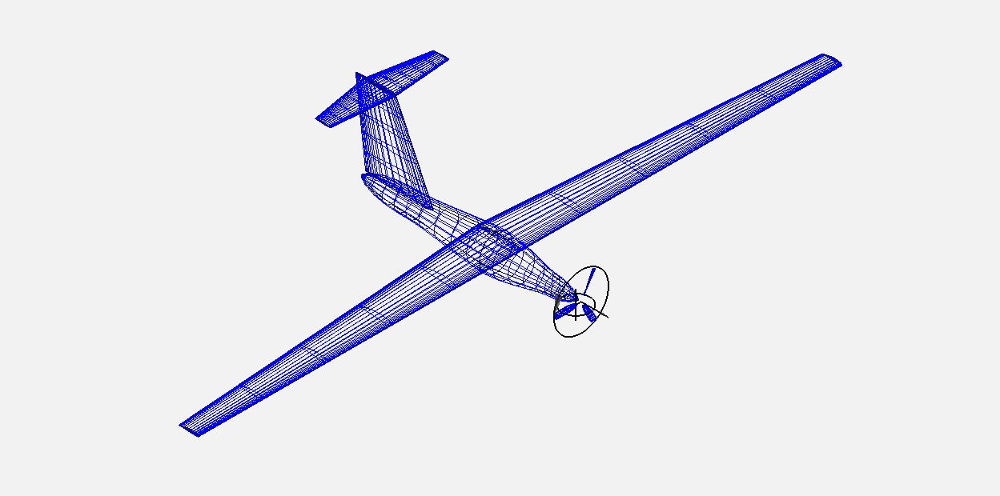

## Overview

The aircraft was first sized from historical and statistical relations (Raymer), then re-converged using a component-by-component weight build-up, an OpenVSP parasite-drag analysis and a 3D lifting-surface analysis in Flow5. Key decisions were cross-checked against at least three independent sources ("triple redundancy").

| Parameter | Value |
|---|---|
| Gross takeoff mass | 1464.5 kg |
| Operating empty mass | 1002.7 kg |
| Fuel (usable + 5% trapped) | 311.8 kg |
| Payload | 150 kg |
| Wing area / span / AR | 27.683 m² / 23.53 m / 20 |
| Wing airfoil / tail airfoil | NACA 4415 / NACA 0009 |
| Wing loading | 518.7 N/m² |
| Powerplant | Continental TSIO-360, 220 HP installed, 3-blade tractor, D = 1.90 m |
| Configuration | Shoulder wing, single boom, T-tail, tricycle gear, chin-mounted EO/IR payload |
| CD0 (cruise, OpenVSP) | 0.01605 |
| (L/D)max (cruise, Flow5) | 31.42 |

## Requirement compliance

| Requirement | RFP target | Result |
|---|---|---|
| Payload | ≥ 150 kg | 150 kg |
| Landing stall speed | ≤ 40 KCAS | 38.8 KCAS |
| Clean stall speed | ≤ 50 KCAS | 47.4 KCAS |
| Cruise speed | 70 KCAS | 70 KCAS |
| Cruise ceiling | > 18,000 ft | Met (141.3 HP required, SL-equivalent) |
| Service ceiling | > 24,000 ft | Met (127.2 HP required, SL-equivalent) |
| Max rate of climb (SL) | > 1200 fpm | ≈ 1487 fpm |
| Endurance | > 24 h | ≈ 33.6 h |
| Operation radius | > 2000 km | ≈ 4165 km |
| Total mission cruise range | 4000 km | ≈ 8330 km |
| Takeoff distance (ISA +30 °C) | < 2000 m | 376 m |

These are conceptual-level predictions from the Breguet model and panel methods, not flight-test values.

## Main findings

1. **Statistical and component-based weights agreed.** The empty-mass fraction from the component build-up (0.660) was within 2.6% of the historical regression (0.643), and gross mass converged from 1483.06 kg to 1464.54 kg (−1.25%).
2. **The assumed parasite drag was pessimistic.** CD0 = 0.025 was assumed; OpenVSP gave 0.01605 (36% lower). This raised (L/D)max from 22.4 to 31.4 and cut the fuel load from 380.8 kg to 311.8 kg.
3. **Pusher to tractor revision.** The initial pusher layout fouled the T-tail and the 1.90 m propeller disk once the full geometry was assembled in 3D. The switch to a tractor with a chin-mounted payload also moved the CG forward and made the aircraft statically stable in every loading condition (static margin 23–34% MAC), including the no-payload ferry case.

## Repository structure

```
male-uav-design/
├── README.md
├── report/
│   └── Final_report.pdf
├── calculations/
│   └── UAV_design_calculations.xlsx
└── figures/
    ├── xflr5_airfoil_comparison/
    ├── openvsp/
    ├── flow5_results/
    └── design_evolution/
```

The OpenVSP, Flow5 and XFLR5 source model files are not included in this repository; only their outputs are shown in `figures/`.

## Calculation workbook

`calculations/UAV_design_calculations.xlsx` contains the **initial sizing phase** of the project (gross mass 1483.06 kg, CD0 = 0.025). The converged values from OpenVSP and Flow5 (1464.5 kg, CD0 = 0.01605) are documented in the report, Section 10.

| Sheet | Content |
|---|---|
| `RFP_İNPUTS` | RFP requirements |
| `02_Unit_Conversions`, `03_Atmosphere` | Unit conversions, ISA atmosphere at the analysed altitudes |
| `04_Competitor_Data` | Bayraktar TB2, ANKA-S, Heron, MQ-1, MQ-9 comparison |
| `05_Assumptions`, `06_LD_and_Speeds` | Design assumptions, induced-drag factor, (L/D)max |
| `07_Mission_Fractions`, `09_Mission_Profiles` | Breguet fuel fractions, endurance and radius mission profiles |
| `08_Weight_Estimation`, `10_Payload_Trade` | Rubber-engine gross weight sizing, payload sensitivity |
| `11_Geometry_Sizing` | Wing area and planform from the stall requirement |
| `12_Constraint_Analysis`, `RAW Constrait`, `Normalization`, `Weight_Norm_Constraint` | Constraint diagram: raw, altitude-normalised and weight-normalised |
| `13_Compliance_Matrix` | Requirement checks |
| `14_Optional Takeoff Distance` | Takeoff distance at ISA +30 °C |
| `15_` | Initial design summary |

## Tools

- **Raymer, *Aircraft Design: A Conceptual Approach*** for sizing methodology
- **XFLR5**: 2D airfoil analysis (Re = 2.5×10⁶, M = 0.15, Ncrit = 9)
- **OpenVSP**: 3D geometry and parasite drag
- **Flow5**: 3D lifting-surface analysis and trim
- **Excel**: sizing loop, constraint analysis, performance checks

## Airfoil selection

Eight airfoils were screened with XFLR5: NACA 2415, 4415, 23015, 65(2)-415, 63(2)-615, S1223, E423 and FX 63-137. **NACA 4415** was selected: it meets the required Cl,max (1.667 vs 1.497 required), matches the 15% thickness target, and has a high stall angle with gradual post-stall decay, which matters for a T-tail aircraft.

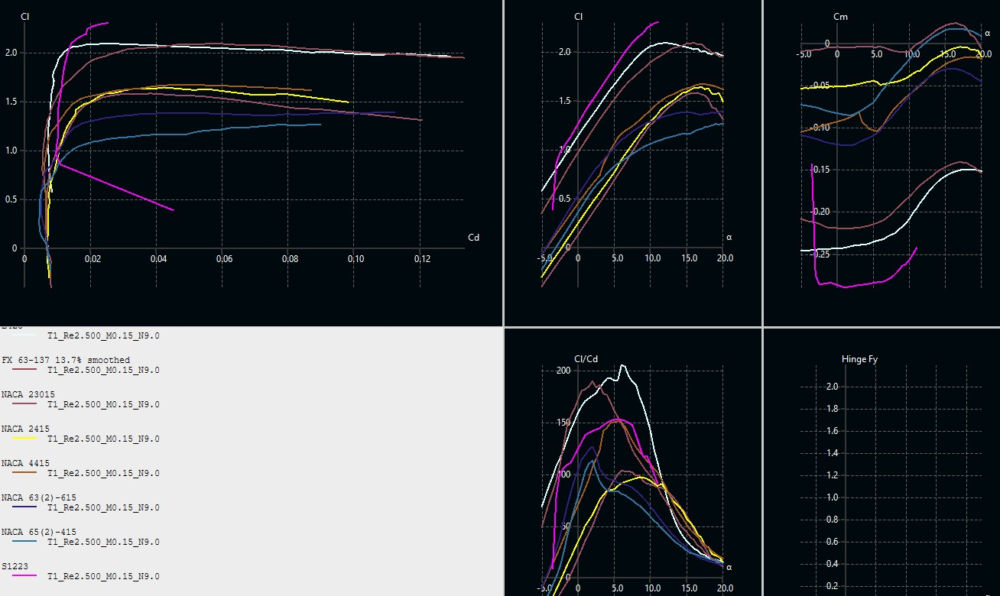

## Geometry and aerodynamic analysis

Final tractor geometry in OpenVSP (top, front and side views):

| Top | Front | Side |
|---|---|---|
| 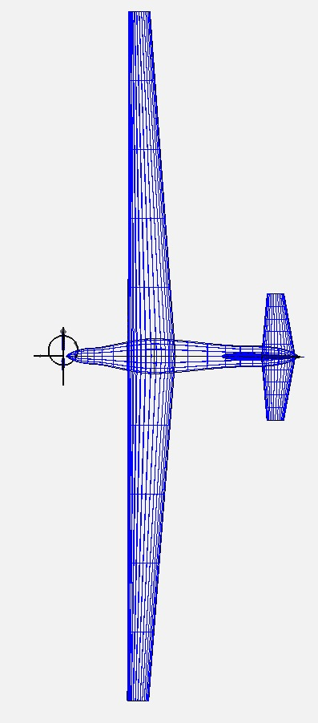 | 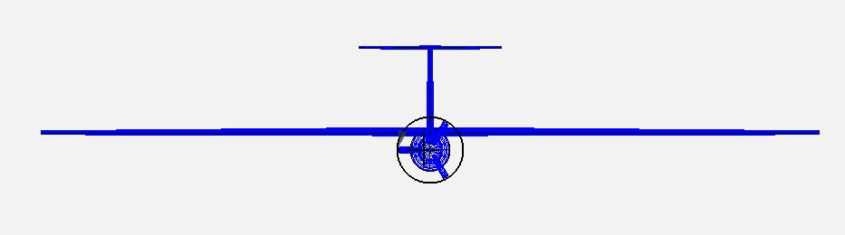 | 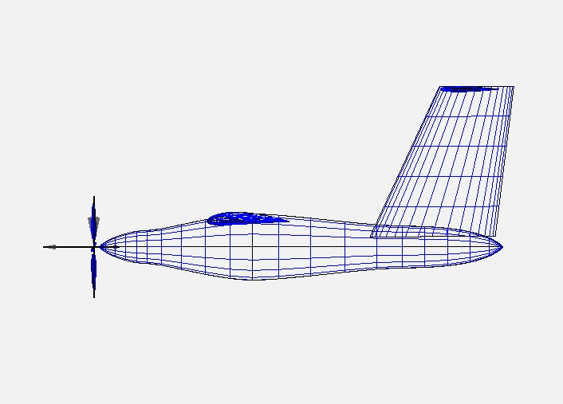 |

Parasite drag from the OpenVSP Parasite Drag tool (CD0 = 0.01605 at 18,000 ft, 0.01631 at sea level):

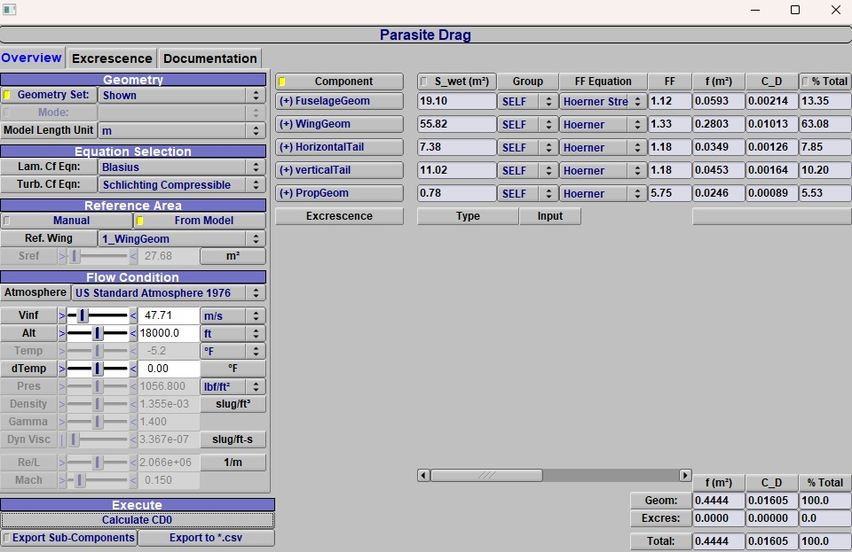

Flow5 3D lifting-surface model (wing, horizontal tail and vertical tail; fuselage and propeller excluded by design) and cruise polars:

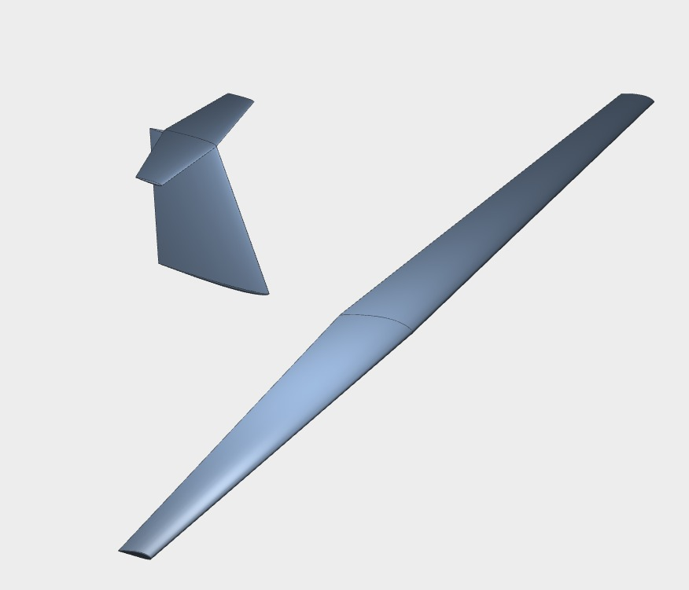

| Lift curve | Drag polar | Efficiency |
|---|---|---|
| 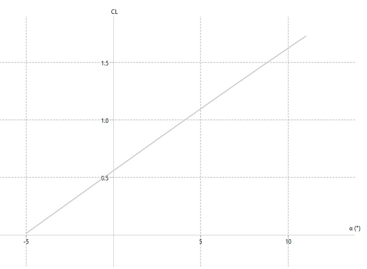 | 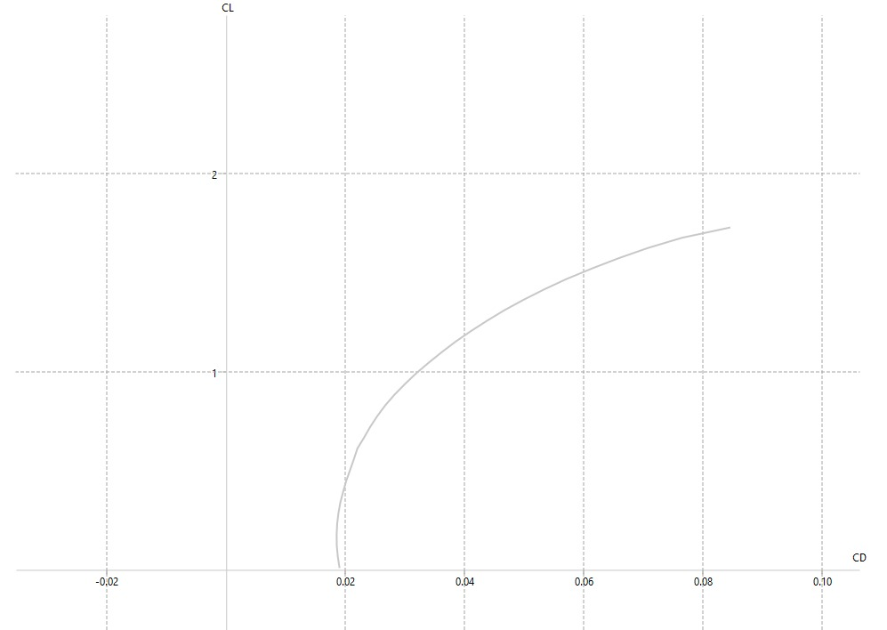 | 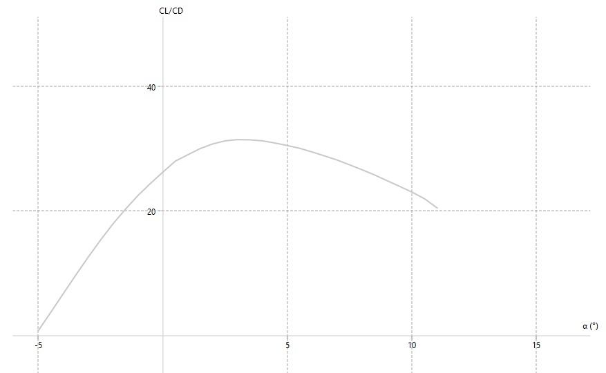 |

## Design evolution

The initial configuration used a pusher propeller. When the complete fuselage, T-tail and 1.90 m propeller disk were assembled in 3D, the aft region was geometrically congested and the tail surfaces would have operated inside the propeller slipstream. The layout was revised to a tractor installation with a chin-mounted payload (see report, Section 2.1). The red marker at the tail in the images below is the pusher propeller disk.

| Isometric | Rear view | Side |
|---|---|---|
| 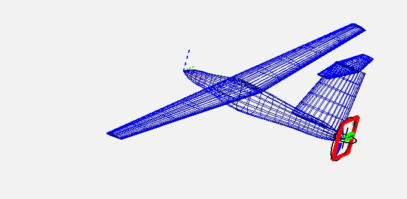 | 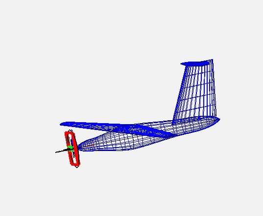 | 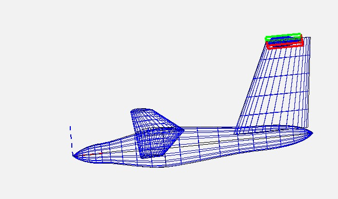 |

## Known limitations

- Aspect ratio (AR = 20) was a fixed input; a formal AR trade study was not performed.
- S1223 polar data contains unconverged points and was not used for selection.
- The Flow5 sea-level (L/D)max (34.12) is inconsistent with the cruise value and is treated as provisional. No performance result depends on it.
- The negative stall limit used in the V-n envelope comes from a 2D XFLR5 polar and is provisional.
- Parasite drag excludes antennas, SATCOM fairings, cooling inlets and gear doors. With a 7% protuberance allowance, CD0 ≈ 0.0172 and endurance drops from 33.6 h to about 32.5 h.
- Weight relations are preliminary conceptual-design estimates.

## Report

The full methodology, equations, trade studies and analysis are in [`report/Final_report.pdf`](report/Final_report.pdf).

## License

Report and analysis are released under CC BY 4.0.
